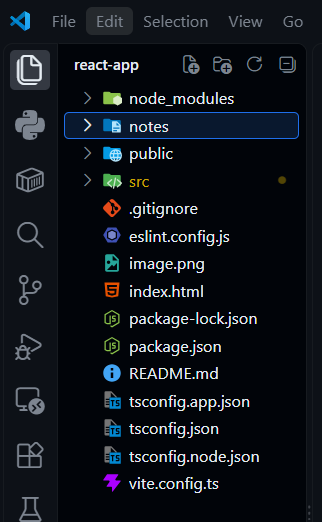

# Creating A React App

>There are two ways to create a react app:
>1. **Create React App (CRA)**: The official tool
>2. **Vite**: a much faster and smaller bundle method
>
>We would be focus on using the more modern method which is Vite.
>
>## Using Vite
>- Open your terminal and run:
>```powershell
>npm create vite@latest  # for the latest version
>
># Or by Specifying the version
>npm create vite@4.1.0
>```
>- Type `y` to proceed installation of the packages:
>- Next, specify the project name: 
>```powershell
>Project name:  vite-project   # change default name to your own
>```
>- Select `React` from the list of frameworks using the arrow keys to move up ↑ and down ↓.
>- Then, select a variant/language: **_JavaScript, TypeScript, JavaScript + SWC, TypeScript + SWC_**
>
>- This will automatically trigger the scalfolding/creation of the project in the chosen directory `:C/Users/Dell/Desktop/react-app` and installation of all the >3rd-party dependencies.
>- Now, open the folder in vscode or any code editor and locate the file `App.tsx` in `src/`. The folder structure should look like this:
>
><div style="text-align: center">
>    </img><br>
></div>
>
>
>- Navigate to `App.tsx`, delete all of its contents and replace with your own code.
>- 🎊 Congratulations!! You just created your first react app.