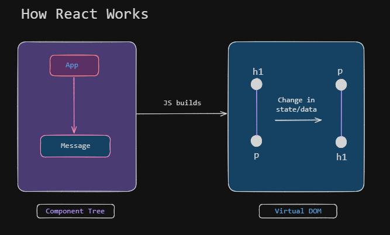

# How React Works

>We can have a component tree with `App` in the root or top-level component and the `Message` as the child. When the  application >starts, React takes the component tree and builds a JS data structure called **Virtual DOM**. This virtual differs from the >usuall DOM as it is  a light-weight and in-memory representation of our component tree. Each node represents a component and its >properties.
>
>A change in the state or data of the components, leads to an update to the corresponding node in the virtual DOM by react. It >then, compares the current state of the virtual DOM with its previous version to identify the nodes that should be updated, and >applies the update:
>
>
><div style="text-align: center">
>    
></div>
>
>Updating the DOM is not done by React itself, but by a companion library called __React DOM__. You can find this in the `package.>json` file:
>
>```tsxon
>{
>    ...,
> "dependencies": {
>    "react": "^19.2.8",
>    "react-dom": "^19.2.8"
>  },
>}
>```
>In addition, at top level the file, [Index.html](/index.html) contains a div container with `id="root"`followed by a script >element referencing [main.tsx](/src/main.tsx) script.
>
>Inside the main script, **ReactDOM** is used to render a component tree inside an element with "root" as it's id. The `App` >component is wrapped by another component, `StictMode`(a built-in comoponent similar to "use strict" in JS) used to identify >potential problems. 
>
>You can either import the **ReactDOM** object or import the **creatRoot** function and use **StrictMode** directly. The former >uses a TypeScript type assertion, while the later allows TS to infer/check the argument.
>
>```tsx
>// With ReactDOM object
>//import
>import ReactDOM from 'react-dom/client'
>
>
>// Call
>ReactDOM.createRoot(document.getElementById('root') as HTMLElement
>    <React.StrictMode>
>        <App />
>    </React.StrictMode>
>)
>
>// Direct Import and Usage
>// Import
>import { createRoot } from 'react-dom'
>
>// Call
>createRoot(document.getElementById('root')!).render(
>  <StrictMode>
>    <App />
>  </StrictMode>,
>)
>```
>
>React is **platform-agnostic** _(i.e. it's not tied to a particular platform)_. It can be used to build apps for web, mobile and >desktop devices. For instance, the same component can also be rendered in a mobile application using a defined library called [**_React Native_**](https://reactnative.dev/). 


